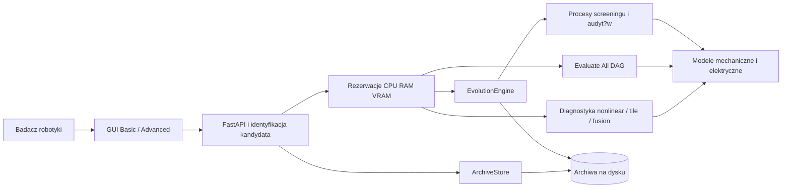
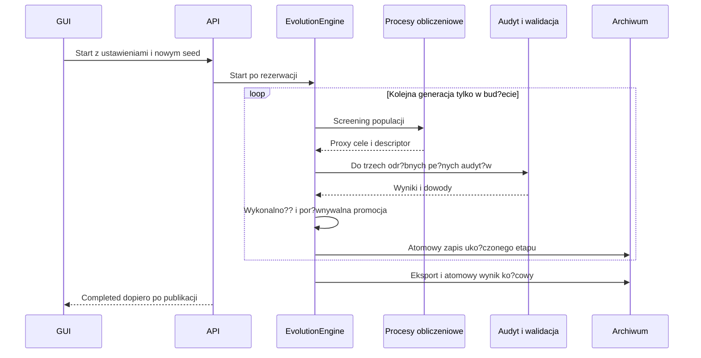
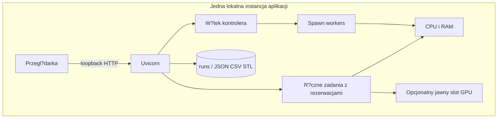

# Architektura NeuroSkin 3

Aplikacja lokalna jest modularnym monolitem Python: FastAPI serwuje jeden interfejs HTML/JavaScript/Plotly. Obliczenia u?ywaj? kontrolera ewolucji, proces?w spawn oraz ograniczonej puli przypadk?w FEM i matrix-free. Nie ma bazy danych ani zewn?trznego brokera. Dane eksperyment?w pozostaj? w `runs/`.

## Granice modu??w

| Warstwa | Pliki i odpowiedzialno?? |
| --- | --- |
| HTTP i kompozycja | `server.py`, `neuroskin_v30/integration.py`: typed requests, wyb?r live/library/archive/stage, expectations i odpowiedzi |
| Ewolucja | `advanced.py::EvolutionEngine`, `search_space.py`, `population_pareto.py`, `finalist_selection.py`: genotypy, zakres, reprodukcja, nominacja i promocja |
| Szybka fizyka | `engine.py`, `electromechanics.py`, `optimization.py`, `piezoelectric.py`, `electronics_evolution.py`: aktywne modele v3; `engine.py` nie jest martwym plikiem |
| Audyt i dowody | `full_evaluation.py`, `evaluation_v30.py`, `validation_contract.py`, `audit_combine.py`, `provenance.py`: jawne poziomy, wsp?lna to?samo?? i brak por?wnania niezgodnych eksperyment?w |
| FEM liniowy | `physical_fem.py`, `beam_fem.py`, `reference_fem.py`, `matrixfree_fem.py`, `gpu_sparse_fem.py`: r??ne backendy, wsp?lne niezmienniki si?/moment?w |
| Filmy i warstwy | `pvdf_array.py`, `pvdf_physics.py`, `laminate_fem.py`, `laminate_shell.py`: przybli?one sprz??enie i postprocessing, nie kompletna kwalifikacja warstw |
| Membrana / multiscale | `membrane_tile.py`, `relaxed_membrane.py`, `nonlinear_skin_tile.py`, `tile_optimization.py`, `neuroskin_multiscale.py` |
| Nieliniowo?? i materia?y | `neuroskin_v30/mesh.py`, `nonlinear_fem.py`, `material_regions.py`: kontrolowane diagnostyki TET4 i regiony materia?owe |
| Zasoby | `compute_admission.py`, `audit_scheduler.py`, `manual_evaluation.py`, `resource_telemetry.py`, `hardware_profile.py`: estymowane rezerwacje i obserwowana telemetria procesu |
| Interfejs | `static/workspace.js`, `workspace_profiles.js`, `workspace_reports.js`, `component_inspection.js`, `fem_previews.js`, `lab_visuals.js`, `workspace.css` |

## Przep?yw pojedynczego eksperymentu

Obiekt kandydata i jego genotyp s? kopiowane przy preview. `expected_live_run_id` i `expected_candidate_id` odrzucaj? nieaktualny wyb?r; rewizje klienta odrzucaj? sp??nione odpowiedzi. Presety nie ustawiaj? seeda i nie startuj? kontrolera. Zmiana Basic/Advanced nie zmienia warto?ci p?l.

`provenance.numerical_source_hash()` obejmuje jawn? list? aktywnych ?r?de? numerycznych i protok??. Ewolucja oraz walidacja korzystaj? z tej samej funkcji. Artefakty starszego lub zmienionego ?r?d?a s? czytelne, ale nie dostaj? nowej to?samo?ci ani automatycznie przeliczonych ocen.

## Wykonanie i trwa?o??

`ArchiveStore` ogranicza identyfikatory i rozmiar odczytu oraz sprawdza rzeczywist? lokalizacj? plik?w i katalog?w etap?w. Wyniki i etapy publikuje si? atomowo. ZIP powstaje w pliku tymczasowym i jest usuwany po wys?aniu; obowi?zuje limit liczby plik?w i 256 MiB danych wej?ciowych. Doko?czenie zadania HTTP nie oznacza spe?nienia kryteri?w fizycznych.

Kontroler i admission s? lokalne dla procesu. Nie zwi?ksza? liczby proces?w Uvicorn, oczekuj?c wsp?lnego stanu. Niezale?ne kontrolery i zarz?dzanie zadaniami pomi?dzy procesami s? osobnym etapem [roadmapy](RELEASE_PLAN_V30.md).
