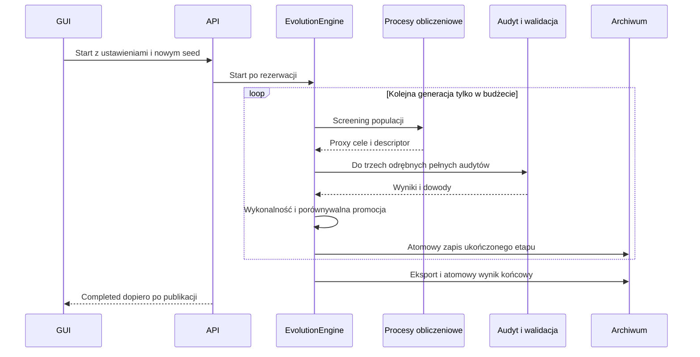
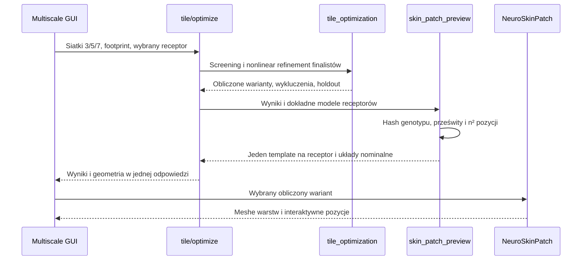

# Architektura NeuroSkin 3

Aplikacja lokalna jest modularnym monolitem Python: FastAPI serwuje jeden interfejs HTML/JavaScript/Plotly. Obliczenia używają kontrolera ewolucji, procesów spawn oraz ograniczonej puli przypadków FEM i matrix-free. Nie ma bazy danych ani zewnętrznego brokera. Dane eksperymentów pozostają w `runs/`.

## Granice modułów

| Warstwa | Pliki i odpowiedzialność |
| --- | --- |
| HTTP i kompozycja | `server.py`, `neuroskin_v30/integration.py`: typed requests, wybór live/library/archive/stage, expectations i odpowiedzi |
| Ewolucja | `advanced.py::EvolutionEngine`, `search_space.py`, `population_pareto.py`, `finalist_selection.py`: genotypy, zakres, reprodukcja, nominacja i promocja |
| Szybka fizyka | `engine.py`, `electromechanics.py`, `optimization.py`, `piezoelectric.py`, `electronics_evolution.py`: aktywne modele v3; `engine.py` nie jest martwym plikiem |
| Audyt i dowody | `full_evaluation.py`, `evaluation_v30.py`, `validation_contract.py`, `audit_combine.py`, `provenance.py`: jawne poziomy, wspólna tożsamość i brak porównania niezgodnych eksperymentów |
| FEM liniowy | `physical_fem.py`, `beam_fem.py`, `reference_fem.py`, `matrixfree_fem.py`, `gpu_sparse_fem.py`: różne backendy, wspólne niezmienniki sił/momentów |
| Filmy i warstwy | `pvdf_array.py`, `pvdf_physics.py`, `laminate_fem.py`, `laminate_shell.py`: przybliżone sprzężenie i postprocessing, nie kompletna kwalifikacja warstw |
| Membrana / multiscale | `membrane_tile.py`, `relaxed_membrane.py`, `nonlinear_skin_tile.py`, `tile_optimization.py`, `neuroskin_multiscale.py` |
| Nieliniowość i materiały | `neuroskin_v30/mesh.py`, `nonlinear_fem.py`, `material_regions.py`: kontrolowane diagnostyki TET4 i regiony materiałowe |
| Zasoby | `compute_admission.py`, `audit_scheduler.py`, `manual_evaluation.py`, `resource_telemetry.py`, `hardware_profile.py`: estymowane rezerwacje i obserwowana telemetria procesu |
| Interfejs | `static/workspace.js`, `workspace_profiles.js`, `workspace_reports.js`, `component_inspection.js`, `fem_previews.js`, `lab_visuals.js`, `workspace.css` |
| Zespół skóry | `skin_patch_preview.py`: geometria genotypu i pozycje obliczonego układu; `static/skin_patch_visual.js`: zgrupowane meshe i interakcje w `neuroskin_v30/lab.html` |

## Przepływ pojedynczego eksperymentu

Obiekt kandydata i jego genotyp są kopiowane przy preview. `expected_live_run_id` i `expected_candidate_id` odrzucają nieaktualny wybór; rewizje klienta odrzucają spóźnione odpowiedzi. Presety nie ustawiają seeda i nie startują kontrolera. Zmiana Basic/Advanced nie zmienia wartości pól.

`provenance.numerical_source_hash()` obejmuje jawną listę aktywnych źródeł numerycznych i protokół. Ewolucja oraz walidacja korzystają z tej samej funkcji. Artefakty starszego lub zmienionego źródła są czytelne, ale nie dostają nowej tożsamości ani automatycznie przeliczonych ocen.

## Przepływ optymalizacji i podglądu skóry

Podgląd korzysta z `advanced.detail_mesh` dla dokładnego genotypu użytego w obliczeniach. Limit 16 000 trójkątów na template przełącza duże modele na jawnie oznaczone osie strukturalne. Replikacja łączy komponenty w jeden trace na część, zamiast osobnego trace na każdy receptor. Pochodzenie geometrii i warunki dopasowania są kontrolowane przed publikacją.

Rekomendacja wybiera najlepszy obliczony wariant osobno dla każdej siatki: najpierw dostępne refinement, następnie wykonalność diagnostyczna i istniejący koszt utility w tej samej wierności. Brak refinement jest widoczny w GUI. Zmiana siatki lub widoczności warstw nie uruchamia ponownego solvera. Podgląd nie generuje pola deformacji. `workspace_reports.js` zapisuje wyniki numeryczne bez dużych, odtwarzalnych template i list pozycji.

## Wykonanie i trwałość

`evolution_continuation.plan` jest wspólnym źródłem planu dziedziczenia dla readonly preview i inicjalizacji kontrolera. Endpoint `POST .../continuation/preview` waliduje kontrolki i zwraca różnice bez rozpoczynania ewolucji. GUI wiąże zaakceptowany podgląd z dokładnym zestawem kontrolek i rewizją żądania, więc opóźniona odpowiedź nie odblokowuje nieaktualnego startu. Pierwszy zgodny odziedziczony genotyp zajmuje jeden ze slotów audytu pierwszej generacji; później obowiązuje zwykła nominacja. Uszkodzone typy kolekcji, konfiguracji i PRNG są odrzucane przed startem.

`evolution_continuation.py` odczytuje wybrany snapshot przez bezpieczny `ArchiveStore`, sprawdza checksum checkpointu i przygotowuje genotypy bez historycznych ocen. API continuation wiąże przygotowane źródło z jego digestem; compute start guard zachowuje wyłączność aktywnej ewolucji. `EvolutionEngine.start(..., continuation=...)` odtwarza zgodne genotypy i opcjonalnie PRNG, nadaje nowy run ID oraz lineage i uruchamia zwykłe oceny. QD/novelty/audit cache zaczynają się od nowa. Numeracja kandydata, etapu i GUI jest zgodna i zaczyna się od generacji rodzica +1.

Po przygotowaniu kolejnej populacji silnik atomowo zapisuje `stages/population_NNNNNN.json`, a następnie odkrywalny `results.json`. Zapisy running/paused/stopping nie dodają modeli do User bests. Szczegóły: [CONTINUATION.md](CONTINUATION.md). Semantyka kolorowanych części i rzeczywisty zakres modeli elektrycznych: [SENSING_MODEL.md](SENSING_MODEL.md).

`user_bests.py::UserBests` przechowuje niezależny od archiwum katalog `runs/user_bests/`. `EvolutionEngine._write_result` wywołuje `capture` po atomowym zapisie wyniku; mechanizm dopuszcza wyłącznie terminalne `completed`/`stopped` oraz `audit_score >90`. Zapis finalizing i snapshoty generacji niczego nie dodają. Jeden niezmienny plik na run zabezpiecza ponawiane zapisy. Do biblioteki trafia istniejący końcowy champion, nie najwyższa ocena proxy populacji ani osobny finalist każdej generacji.

`GET /api/user_bests` zwraca metadane wpisów, a `GET /api/user_bests/{run_id}` dokładnego kandydata z osobną tożsamością `user-best-{run_id}`. Selekcja `user_best` działa w istniejących ścieżkach inspekcji, eksportu, Evaluate All i Multiscale bez zależności od bieżącej instancji ewolucji. Historyczne audyty zachowują swoje oryginalne tożsamości. GUI odświeża trzecią kategorię przy zakończeniu runu, otwarciu Library lub użyciu Refresh.

`ArchiveStore` ogranicza identyfikatory i rozmiar odczytu oraz sprawdza rzeczywistą lokalizację plików i katalogów etapów. Wyniki i etapy publikuje się atomowo. ZIP powstaje w pliku tymczasowym i jest usuwany po wysłaniu; obowiązuje limit liczby plików i 256 MiB danych wejściowych. Dokończenie zadania HTTP nie oznacza spełnienia kryteriów fizycznych.

Kontroler i admission są lokalne dla procesu. Nie zwiększać liczby procesów Uvicorn, oczekując wspólnego stanu. Niezależne kontrolery i zarządzanie zadaniami pomiędzy procesami są osobnym etapem [roadmapy](RELEASE_PLAN_V30.md).
