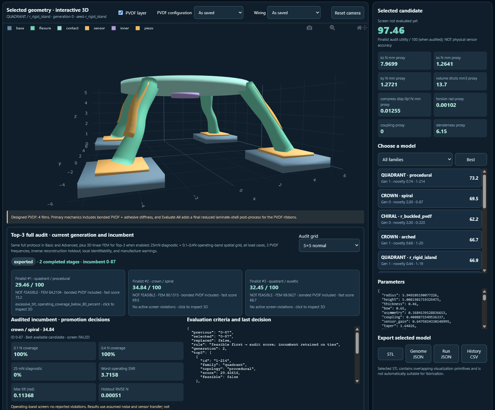
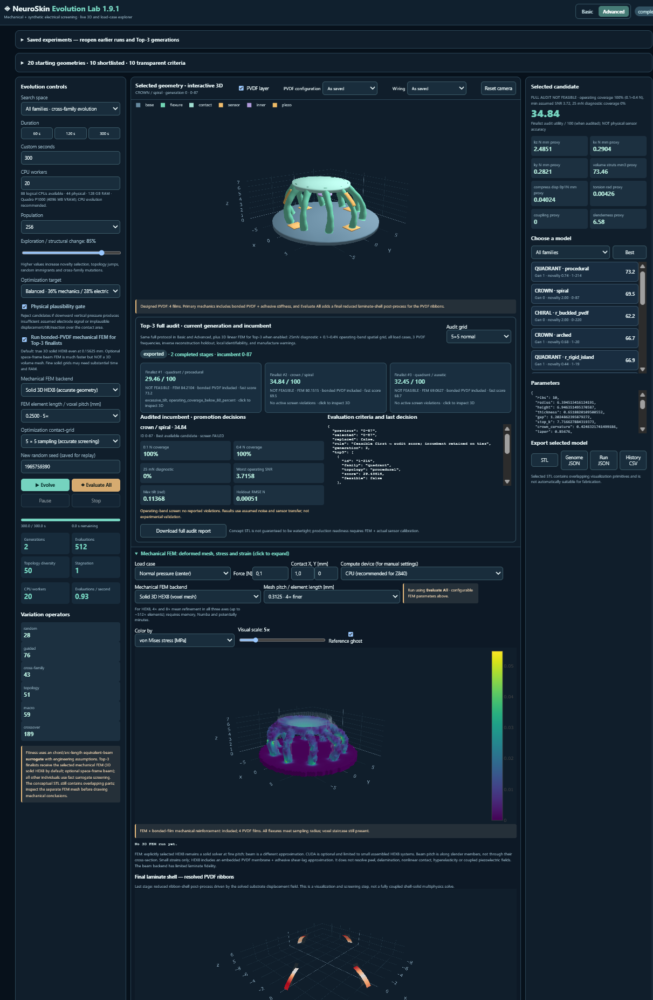
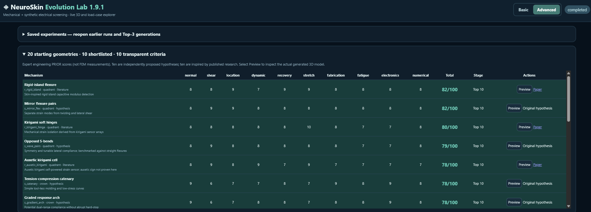
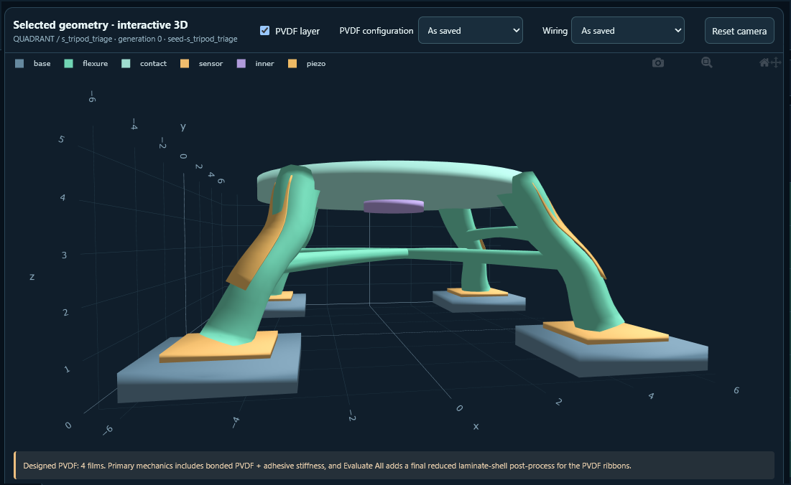
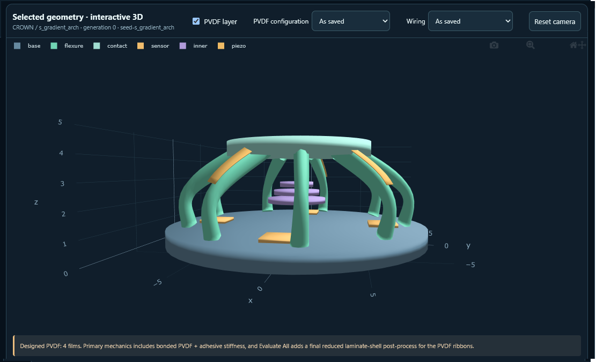

# NeuroSkin Evolution Lab 1.9.1



**Windows 11 / Python 3.14 / Quadro P1000 installation:** `python -m pip install -r requirements.txt` then `python server.py --cores auto --open --port 8765`.

This refinement makes **feasible-first Top-3 selection** consistent after the complete FEM and laminate-shell audit, corrects the operating-band pressure diagnostics (0.1/0.4 N vs separate 25 mN diagnostic), adds sensor-gap/electrode-area/mount-compliance genetic parameters, and provides gradient-guided mutations rather than plateauing on hard failures. The single **Evaluate All** button continues to update all inspectors. Saved experiments remain accessible, but previous fitness values are historical and incomparable until recalculated.

Read [RELEASE_NOTES_v191.md](RELEASE_NOTES_v191.md) first for scientific limitations, test commands, complete change list and references. `refinement_benchmark.py` generates a reproducible initial-population report, and `render_refinement_preview.py` generates a spatial SNR comparison for an unchanged symmetric Quadrant mechanism under two electronic-design assumptions.

---

# NeuroSkin 1.9 — CURRENT RELEASE (read before historical notes)

## What changed in v1.9
- Added a **final laminate-shell post-processing stage** for resolved PVDF ribbon mechanics after the substrate FEM solve.
- Added UI support for a **final PVDF ribbon-shell graphic** and shell summary metrics in the Mechanical FEM area.
- Integrated the shell stage into **Evaluate All** and into the **Top-3 full audit** decision basis.
- Added preview artifact `LAMINATE_SHELL_PREVIEW_v19.png` plus a helper script to regenerate it.

- Full instructions and physical limitations: [RELEASE_NOTES_v18.md](RELEASE_NOTES_v18.md).
- One primary **Evaluate All** action updates actual mechanical FEM, load-case/electrical and spatial-pressure inspectors. The Top-3 audit panel is displayed under the 3D viewer, above mechanical FEM.
- **Mechanical PVDF + adhesive contributions are now approximated in the FE equation** (embedded membrane shear-lag for HEX8 and composite-rod approximation for beam). The same laminate parameters affect fast fitness and the complete Top-3 audit each generation when FEM is enabled.
- The older paragraphs below document how previous releases worked; statements saying PVDF stiffness is absent describe those **old versions**, not v1.8.
- Installation: `python -m pip install -r requirements.txt` then `python server.py --cores auto --open --port 8765`.



---


**Installation (Windows 11, Python 3.14, Quadro P1000):**

```powershell
python -m pip install -r requirements.txt
python -m pip check
python environment_doctor.py --gpu
python server.py --cores auto --open --port 8765
```

One `requirements.txt` contains **all** dependencies, including Numba, CuPy CUDA 12 `[ctk]`, Gmsh, scikit-fem, meshio and PyVista. Expect larger installation/downloads (VTK/CUDA). The installed CuPy 14.x and driver are preserved by pip if they satisfy the requirements. `launch_windows.bat` starts the app and no longer reinstalls packages. `install_windows.bat` performs installation and a dependency check once.

**Your verified baseline:** Quadro P1000 CC 6.1 / 4 GiB VRAM; CUDA12 CuPy CG smoke test passed. At 125 HEX8 elements, CPU 0.014618 s vs CUDA 21.964896 s cold. For this size, GPU is **~1502× slower in total wall time**, not a winning backend. GPU remains opt-in; CPU and Numba matrix-free HEX8 remain defaults for 4×/8× meshes.

**Hardware affinity correction:** Windows reports 88 host threads, but this process reports access to 44. With SMT2 the conservative accessible physical-core estimate is 22; auto worker recommendation is approximately 20 rather than the old 40. Actual NUMA/processor-group reach must be measured, not inferred solely from affinity counts. Use `python hardware_profile.py --json`, then benchmark 12/16/20/24/32 workers to establish the fastest configuration.

**Fairer benchmark:**

```powershell
python hardware_benchmark.py --family quadrant --pitch 1.25 --repeats 5 --warmup 2 --case normal --out gpu_vs_cpu_v17.json
python hardware_benchmark.py --family quadrant --pitch 1.25 --repeats 5 --warmup 2 --case offset --out gpu_offset_v17.json
```

It reports setup/first solve separately from warm repeated solves, plus whole-field numerical agreement. GPU is recommended only if the entire measured workflow is faster and displacement fields match. **Do not equate CUDA correctness with GPU acceleration.** Your `CUDA_PATH` warning is not necessarily fatal with the `[ctk]` wheel; the code filters only the specific toolkit-path warning during validated CUDA initialization, leaving genuine errors visible. Avoid inventing `CUDA_PATH` pointing to the driver directory.

**Scope unchanged:** all FEM models still use small-strain linear elasticity. Optional Gmsh/scikit-fem/PyVista packages are installed as requested, but the production simulation engine does not silently switch to those packages or claim nonlinear hyperelasticity. The current PVDF stiffness still is not incorporated into continuum mechanics. Scoring remains an engineering surrogate with Top-3 FEM checks, not measured tactile-sensor accuracy.

See [RELEASE_NOTES_v17.md](RELEASE_NOTES_v17.md), [WORKSTATION_HP_Z840.md](WORKSTATION_HP_Z840.md) and [RELEASE_NOTES_v16.md](RELEASE_NOTES_v16.md).

---

## Example

```bash
python -m pip install -r requirements.txt
python server.py --cores 8 --open --port 8765
# From a second terminal, deterministic headless run:
python evolve_cli.py --cores 8 --seconds 120 --population 96 --mode all \
  --objective balanced --gate --grid 3 --audit-grid 5 --out runs_120s
python -m unittest discover -s tests -q
```

Full audits are **compute intensive**. A timed run can exceed the selected duration by the remainder of its in-flight generation and export operations. With 32 process workers, a population of 96 or 128 is usually a better starting point than 24, but CPU saturation is workload and hardware dependent. More processes do not guarantee a faster run.

### Interpretation of a 'full' audit

**Full refers to exhaustive coverage of the implemented *surrogate* tests, not high-fidelity verification.** No nonlinear FEM, dielectric field solver, fracture, durability, creep, contact friction, or physical calibration is performed. Contact-pad displacement is reduced to six degrees of freedom, electrical signals depend on assumed electrode/gap and noise parameters, and rank tests are local numerical measurements. A candidate can be called *feasible under screening assumptions*, **never 'physically validated' or 'production ready'**.

### Relevant research / patent checks

These sources motivate parameters and warn against treating structural design as automatically patentable:

- Nature Materials (2026), [Multiscale-structured miniaturized 3D force sensors](https://www.nature.com/articles/s41563-026-02508-7) — multimaterial geometric separation of normal/tangential force; motivates off-center contact, sensor cross-coupling, and minimum detectable force.
- Advanced Materials Technologies (2026), [Mechanical Decoupling of a Multiaxial Force Sensor via Multiple Sensing Mechanisms](https://advanced.onlinelibrary.wiley.com/doi/10.1002/admt.71078) — architectural decoupling; motivates separate observability/reconstruction audits.
- Chemical Engineering Journal (2026), [Geometry-mediated decoupling of multidimensional forces in flexible anisotropic tactile sensors](https://www.sciencedirect.com/science/article/abs/pii/S1385894726085177) — geometry and bending immunity; motivates substrate-strain nuisance tests.
- Patent application [WO2022056223A1](https://patents.google.com/patent/WO2022056223A1/en) — stretchable kirigami interconnects and multimodal electronic skins are prior art, not automatically novel.

These references do not constitute novelty or freedom-to-operate opinions. The code should not be used to justify patent claims or physical device specifications without independent verification.

---

# NeuroSkin Evolution Lab 1.2 — saved experiments and generation replay

## How to inspect the results after running and restarting the application

1. Run an evolution normally, wait until **completed**. The application writes
   `runs_v05/<run_id>/results.json`, CSV history, champion STL and a `stages/`
   directory containing one atomic JSON for **each completed generation**.
2. Restart the application (`python server.py --cores 8 --open --port 8765`).
3. At the top of the GUI open **Saved experiments** → **Refresh** → select a run
   → **Open**. Its final audited champion, gallery, final Top-3, history and
   decisions are restored to the normal viewer. The archive is read-only.
4. Under **Generation** choose any stored generation and **Inspect stage**.
   Click one of the three finalist cards to pin that model in the 3D viewer.
5. In **Advanced**, run electrical load cases and the spatial downward-pressure
   scan against the actual saved genome, or export that specific model as STL.
6. Use **Download selected run ZIP** to export the saved result, audit history,
   conceptual STL and per-generation stage snapshots. **Return to live** to
   resume viewing ongoing evolution or start another experiment.

**Important:** a headless CLI run written to `runs_headless/` is NOT automatically
visible in the GUI, which uses `runs_v05/` next to `server.py`. Run the CLI with
`--out runs_v05` if you want to open its outputs in the GUI.

### Archived experiments and comparison

Advanced mode also provides **Compare this run with**. Scores are compared
only if objective, audit protocol and the recorded *exact source hash* match.
Older runs without a model hash can be opened but are intentionally marked
**not directly comparable**. A better relative surrogate score does not imply
better hardware performance.

### Improvements and bug fixes

- Archive management is path-safe, bounded, read-only, robust to incomplete JSON,
  and provides a persisted run ZIP without executing stored code.
- Every Top-3 stage is atomically written after the identical full surrogate audit.
  Existing `results.json` remains backward compatible with v1.0.
- Run state includes model source-code SHA-256, software release version and
  the surrogate-validation level, improving reproducibility and audit safety.
- Terminal completion is **only published after** the final archive has been
  atomically saved. This eliminates a race in tempfile-based regression tests.
- Three **distinct** genomes are chosen for Top-3 whenever the population
  contains at least three unique geometries. Duplicates do not waste audit slots.
- `archive_store.py` is independent of the evolutionary optimizer for safe
  inspection, and archived load-case evaluation uses the original stored genome.
- Added 1.1 archive/API/security tests and a release regression runner:
  `python verify_release.py` (Node.js is optional for JS static checks).
- Old Basic/Advanced behavior remains unchanged: both call exactly the same
  computation pipeline. GUI only changes visibility and configurable settings.

### Limits

This is **production-oriented research software**, not a formally qualified
industrial product. We have not validated browser rendering on all browsers,
thread/process crash recovery across operating systems, security hardening for
untrusted remote clients, nonlinear FEM convergence or physical piezoelectric
accuracy. Bind the server to localhost (the default); do not expose the
FastAPI service on the public internet without authentication and deployment
hardening. The STL is a conceptual overlapping assembly, not a certified
single solid. See `RESEARCH_AND_VALIDATION.md` for rigorous release and
physical validation criteria and prior art.

### Repeatable verification

```
python -m unittest discover -s tests -q
node tests/test_deformation.js
python verify_release.py --smoke-evolution
```

The final command intentionally executes a real three-second evolution and
saves it under `runs_v05/` so it can be reopened from the GUI.

## v1.5.1 Windows Python 3.14 / Pascal CuPy hotfix

The optional CUDA 12 package in v1.5 mistakenly pinned CuPy 13, which does
not provide Windows Python 3.14 wheels. In v1.5.1, use:

```powershell
python -m pip install -r requirements.txt
python gpu_selftest.py
python hardware_benchmark.py --family quadrant --pitch 1.25 --out gpu_vs_cpu.json
```

CuPy 14 CG requires `rtol`/`atol` rather than `tol`, fixed in the application.
Your Quadro P1000 is Pascal compute capability 6.1 and requires CUDA 12.x code.
`nvidia-smi` reporting CUDA 13.0 refers to driver compatibility, not an installed
CUDA 13 Toolkit requirement. Keep CPU as the default solver until you benchmark.






